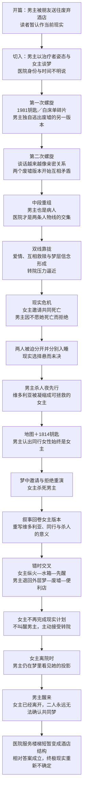

# 剧本小说读者时间线 v2：螺旋式双线

> 当前有效版本。它只规定读者接收信息与情感推进的顺序，不提前固定章节数量、具体场面或对白。

## 一、核心结构

小说不把“医院现实—过去—梦境”排列成三个整齐板块，而让三条线围绕相同意象反复靠近：

- **男主线**：被朋友送往废墟的“当前经历”——后揭示为男主外层梦。
- **女主线**：心理谈话、破碎记忆和被转院压力——后揭示谈话对象也是病人。
- **交集线**：精神病院中的真实爱情与共生——逐渐成为两场杀人夜共同的心理材料。

每次回到同一意象时，意义必须改变：白床单从幸存变成裹尸与醒来；1814钥匙从指控变成梦层罪证；“醒来”从安慰变成死亡邀请，最后变成无法确认的永别。

## 二、读者顺序总图

## 三、五次螺旋推进

### 第一圈：读者把梦当现实，把病友当医生

1. **男主抵达**：由朋友送往废弃酒店附近。男主状态正常，像主动寻找某个答案。叙事在他真正入睡以前切断。
2. **第一次谈话**：男主提问、记录，女主谈“醒来”；不交代场所全貌，不提供任何医生职权证据。
3. **女主碎片**：1814钥匙、烧焦白床单、坠落感短暂进入正文，既可读成记忆，也可读成梦。
4. **矛盾版本**：插入男主曾经精神失常、独自从废墟逃到便利店的经历；它与开篇“朋友送达”的版本无法同时成立。

此时读者的主要问题不是“谁是真凶”，而是：**哪个男主正在做梦？哪个空间属于现在？**

### 第二圈：心理治疗逐渐变成相互依恋

5. 男主继续以引导者姿态理解女主，女主则逐渐记住和回应他的私人细节；双方的位置开始悄悄互换。
6. 1964童年火灾、母亲死亡和假醒体验，以女主当前谈话所触发的感觉插叙进入，不形成完整传记段落。
7. 1981旧案只出现屋顶、雨棚、洗衣车、钥匙和火灾余波；可靠来源始终只确认火灾。
8. 男主客观废墟经历得到补足：便利店老板报警，他被接走送医。读者因此知道废墟确实存在，却仍无法解释开篇版本。
9. **中段身份重组**：某个无法伪装的制度性动作同时约束男女主，读者确认男主也是病人。前面的“治疗”被重新理解为他借用拯救者位置建立亲密。

从这一节点以后，小说可以真正开放女主的医院内心视角；此前不得利用她明知男主是病人却故意不想这件事来欺骗读者。

### 第三圈：现实先提出问题，梦再把问题推到极端

10. 男女主双线开始平等推进。他们确实相爱，也形成只有彼此能理解的语言与梦感，但不直接调查酒店或共同编写梦境。
11. 女主把男主视为能够跨梦层找到自己的依恋对象；男主则越来越相信自己能够把她带回一个稳定现实。
12. 转院从传闻变成正式决定。分离不再是抽象恐惧，而成为次日就会发生的事实。
13. **现实共同死亡邀请**：女主把计划推到可执行边缘，要求男主与她一起“醒来”。
14. **现实拒绝**：男主拒绝，不是因为不爱，而是因为不愿女主死亡，也不让毁灭冒充救赎。
15. 女主因爱产生迟疑；院方介入，将两人分别安置。转院因此既有制度理由，也成为两人关系造成的现实后果。
16. 两人在不同空间入睡。现实选择没有完成，直接进入各自的梦。

### 第四圈：杀人夜不是案件复原，而是爱情的梦工作

17. **男主版本先行**：火灾前酒店、十三人、停电、女经理与维多利亚出现。男主把“能够被自己拯救的女主”凝缩到维多利亚身上。
18. 女主杀死维多利亚。维多利亚逐渐失去女主面貌特征；男主第一次意识到自己一直在拯救一个由欲望制造的载体。
19. 火灾前地图与火灾后废墟地图互补，1814钥匙从维多利亚转移到同行女性手中。男主主动认出：同行者、女经理、凶手和现实女主始终是同一个人。
20. 梦中共同死亡邀请重演。男主再次拒绝；女主杀死男主。男主没有醒回医院，而是退到自己独有的外层梦。
21. **叙事回卷**：女主版本回到杀人夜开场。她始终看见自己，不存在换脸；相同事件只保留能增加动机、情感因果和主体差异的部分。
22. 女主看见男主奔向维多利亚，把他的拯救体验为：他选择了一个方便拯救的理想替身，而不是真实的她。
23. 女主版本追上梦中拒绝、杀死男主、纵火与水箱。她在水箱“获救”时先醒回医院。

杀人夜高潮由两条线共同完成：男主线回答**“我错把谁当成了她？”**；女主线回答**“被爱人错认成替身之外的人是什么感受？”**

### 第五圈：她已经醒来，他仍在梦里

24. 女主醒来时，男主仍在外层梦中。她无法确认男主是否经历了相同的杀人夜，也不知道死亡会把他带到哪里。
25. 她获得最后一次行动机会：反抗转院、返回男主身边并完成现实计划，或者让他继续活着。她选择后者。
26. 女主不叫醒男主，也不要求最后见面；她主动配合转院。这个“不见”是她最后一次爱他的行动，而不是冷漠或放弃感情。她只把先前用于判断清醒的纸折成三折，从门下留给男主；纸背只有“有一天我们一定会再见的”，不解释梦、死亡或去向。
27. 与女主办理转院、经过男主房间但没有进去的现实线交叉，男主在外层梦中从废墟逃向便利店。
28. 梦中老板明确指认女主是杀人犯；男主看见由自己凝缩出的女主投影。这个投影出现时，现实中的女主正在离开。
29. 男主终于从外层梦醒回医院，发现女主已经转院。他不知道她是否做过同一场梦，也不知道她为何没有叫醒自己；那句最后留言既可读成要求他活着等待，也可能延续她对另一世界的信念，不能替两人完成确认。
30. 男主沿废墟记忆在医院转弯，短暂看见不应存在的酒店服务楼梯；回头后恢复正常。

结尾不给他们最后一次解释、拥抱或确认。**读者比男女主多知道一件事：他们确实在各自的梦中抵达过彼此，却仍无法证明那是不是同一个世界。**

## 四、三种时间手法的分工

| 手法 | 使用方式 | 不能做什么 |
|---|---|---|
| 倒叙 | 以时间较后的男主外层梦开篇，再回到关系形成期；女主版本在男主被杀后回卷至杀人夜开场 | 不能提前解释开篇是梦，也不能只为了故弄玄虚 |
| 插叙 | 1964、1981和男主客观废墟经历由医院当下的词语、动作、物件或身体感觉触发 | 不能完整复原旧案，不能由可靠来源宣布维多利亚是真凶 |
| 平行交叉 | 女主醒后接受转院，与男主仍在外层梦中逃离废墟、接受指控并看见投影交叉 | 不能暗示女主真的进入男主外层梦 |

## 五、读者应当经历的五次判断变化

1. **最初**：男主正在现实中调查废墟，也许是女主的治疗者。
2. **第一次修正**：男主去过废墟，但开篇与客观经历不是同一次；他也不是医生。
3. **第二次修正**：女主并非只有“被治疗者”位置，两人正在互相塑造和依赖。
4. **高潮修正**：维多利亚不是女主，同行女性才一直是女主；两场杀人夜高度重合却不属于同一个主体。
5. **最终理解**：梦让两人抵达彼此，也延迟了男主的醒来，使他们永远错过最后一面；相对层级可以重建，但终极现实仍不可证实。

## 六、写作约束

- 切线必须由相同意象、动作、语言或空间关系触发，不能用随意跳时制造混乱。
- 每次回返过去都要改变读者对身份、时间、罪责或关系意义的至少一项判断。
- 男主病友身份揭晓前，女主医院内心视角必须受到公平限制；不能让她为了替作者保密而产生不自然的思想空白。
- 男主和女主的杀人夜不能机械复制；重复场面必须改变主观意义。
- 女主先醒、主动接受转院与男主晚醒，是结局的核心动作链，不得增加梦后会面、伤处确认、解释性遗书或最后通话；只允许保留已经锁定的单句留言，不得扩写为说明信。
- 鸟意象只在少量关键节点出现：医院撞窗触发、维多利亚旧案碎片、童年火灾来源与杀人夜错选。每次必须改变意义，不能发展成高频惊吓机关。
- 男主最终无法知道女主是否共享杀人夜；这种无法确认正是梦作为恩赐与惩罚的最后落点。
