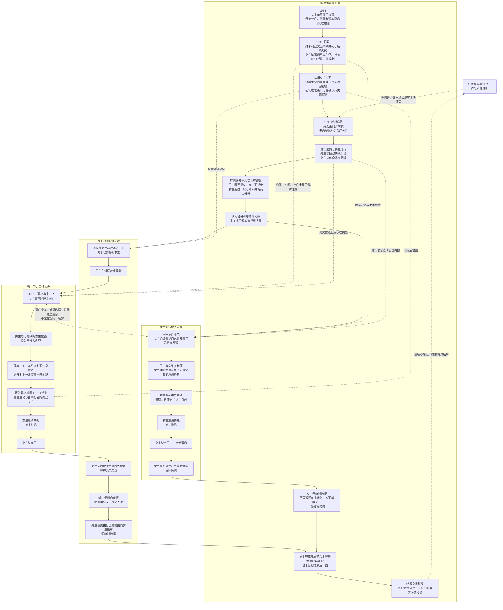
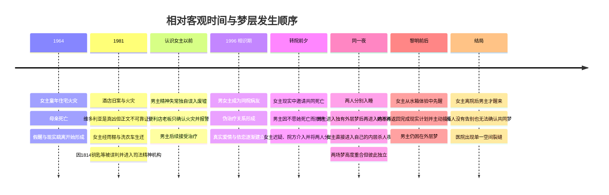

# 世界观、底层逻辑与多层时间线链接图 v1

> 用途：作者内部事实账。这里记录“实际发生了什么”，不代表小说向读者展示信息的顺序。

## 一、不可越过的核心命题

梦既是心理给予人的恩赐，也是惩罚。它把创伤、记忆、欲望与依恋凝缩成一个可以逃入的世界，使人获得现实中无法得到的理解与救赎，也可能夺走辨认现实的能力，使人被困在自己营造的虚无之中。

男女主的爱情、依恋、拯救与共死冲动，是这一命题的人物化表达。两人确实相爱，也确实完成了情感互通；投射会扭曲爱情，但不能取消爱情的真实性。

## 二、世界层级总链接图

## 三、故事底层行动逻辑链

```mermaid
flowchart LR
    A[女主的创伤、假醒与旧案误判] --> B[相信世界由多层梦组成<br/>死亡可能使人醒来]
    B --> C[把男主视为能跨梦层找到自己的依恋对象]

    D[男主以拯救他人确认自身价值] --> E[借用心理医生／治疗者姿态接近女主]
    E --> F[想把女主带出困境]

    C --> G[两人建立真实爱情、依恋与情感互通]
    F --> G
    G --> N[现实中女主邀请共同死亡<br/>测试能否在下一层继续相遇]
    N --> O[男主拒绝<br/>因为不让毁灭冒充救赎，也不愿女主死亡]
    O --> T[女主迟疑、院方介入<br/>两人被分开入睡]
    T --> H[梦把未完成的现实选择<br/>及依恋对象重新凝缩]

    H --> I[男主把可拯救的理想女主投射为维多利亚]
    H --> J[女主把维多利亚体验为被男主选择的理想替身]
    I --> K[男主本能拯救维多利亚<br/>暂时看不见真实女主]
    J --> L[女主杀死维多利亚<br/>迫使男主面对真实的自己]

    K --> M[两张地图与1814钥匙闭合<br/>男主认出真实女主]
    L --> M
    M --> P[梦中邀请与拒绝重演<br/>女主杀死男主并纵火<br/>把依恋推到毁灭性完成]
    P --> Q[女主先醒<br/>发现死亡与醒转不能保证两人同层]
    Q --> R[她因不愿男主死亡而接受转院<br/>男主晚醒并错过告别]
    R --> V[两人无法确认是否共享过梦<br/>以未被说出的放手保护对方]
    V --> S[梦给予救赎，也可能使人失去辨认现实的能力]
```

## 四、作者事实时间线

## 五、梦层运行规则

1. **触发条件**：转院通知造成迫近的分离压力；现实中的共同死亡邀请、男主拒绝和随后被迫分开，使未完成的选择成为两场杀人夜的共同心理起点。
2. **相同部分**：酒店事件骨架、关键人物位置、主要死亡、男主的拒绝及结局走向。
3. **不同部分**：人物面貌、动机理解、情感体验、维多利亚承载的投射，以及谁能看见女主真实身份。
4. **性质边界**：作品可以呈现为“灵魂共振”，但不证明超自然共享梦，也不把梦解释成两人刻意共同编写的案件。
5. **醒转路径**：女主在水箱获救体验中直接醒回医院；男主在内层被杀后退回独有外层梦，继续经历废墟、便利店指控及女主投影，因此比女主更晚醒来。
6. **永不确认**：女主在男主仍处于外层梦时接受转院；男主醒来时她已经离开。两人无法核对梦境，只有读者通过双版本并置知道其高度重合。

## 六、信息可靠性与公平线索

- **年代物件**：1964、1981、1996各自拥有可回溯但不被旁白解释的物件与环境差异。
- **建筑空间**：火灾前酒店、火灾后废墟、精神病院三套空间既有重合又有可核对差异；男主掌握火灾后地图，女主掌握火灾前服务通道。
- **人物信息权限**：可靠来源只确认火灾；凶案和凶手只来自梦、传闻、残缺记录、精神失常者经验与作者层事实。
- **每次跨层至少改变一项**：年代物件、建筑状态或人物可知信息。重复意象负责连接，差异负责让读者最终重建层级。
- **终极现实不证实**：结尾空间裂缝只重新打开“医院是否为终极现实”的疑问，不推翻已经解开的相对梦层结构。

## 七、术语硬边界

- **旧案**：只指1981年客观发生的酒店凶案与火灾。
- **杀人夜**：只指男女主相遇后，各自经历、彼此高度重合的内层梦中梦。
- **外层梦**：只属于男主；女主从未客观进入。
- **共同梦／共梦**：仅为“两个高度重合的独立内层梦”的简称，不代表两人进入同一个客观梦境空间。
